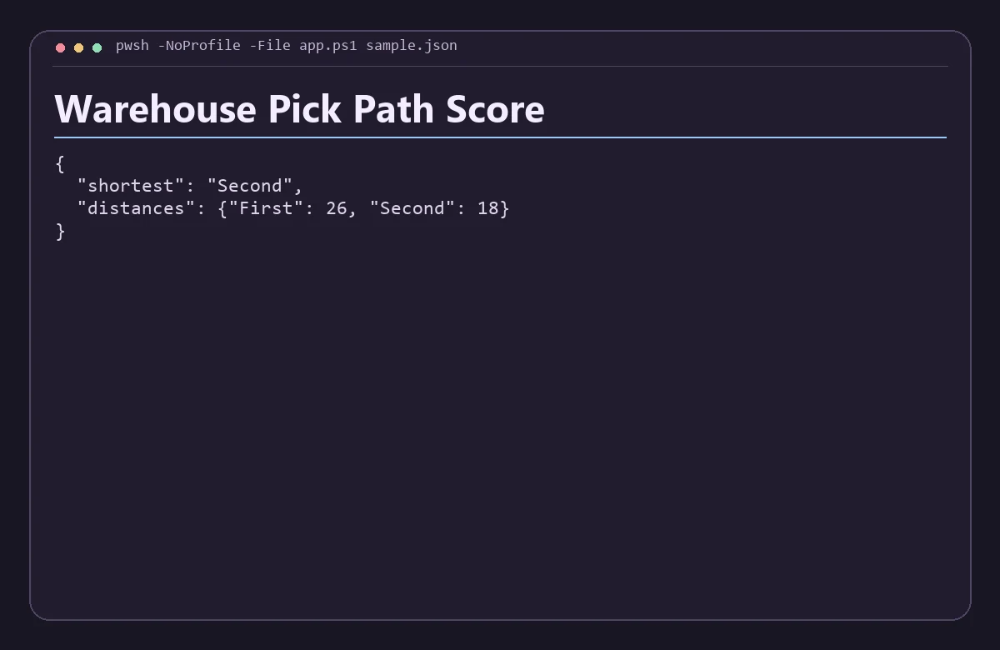

# Warehouse Pick Path Score

Compare two or more pick orders on a rectangular grid and show their travel distances.



## Run

Install PowerShell 7 or newer. Run these commands from the repository root.

```sh
pwsh -NoProfile -File app.ps1 sample.json
```

Replace `sample.json` with a JSON file following the same structure. The app prints a JSON report to standard output.

Coordinates are integral grid points. Routes must visit every pick exactly once and return to the depot. Distances use a Manhattan grid.

## Verify

Run `python check.py` with Python 3.11 or newer after the build step when applicable. The check verifies the bundled scenario and confirms that an invalid input returns an error.
